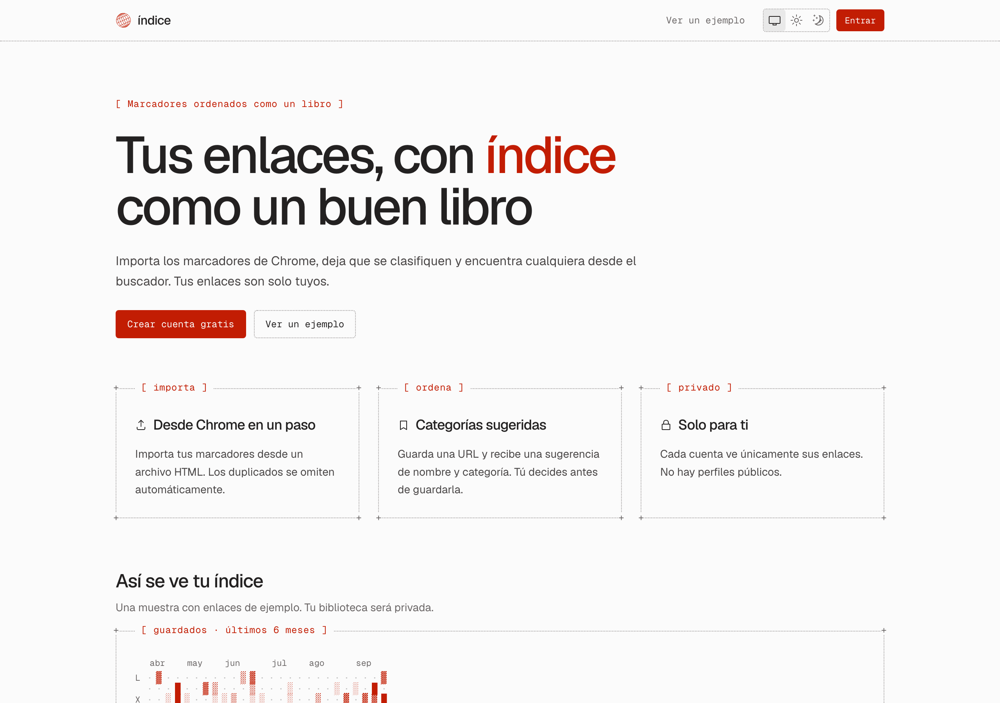

# índice

Guarda y ordena tus enlaces como el índice de un libro. Cada persona tiene su cuenta y sus enlaces son privados.

**En producción:** [indice-phi.vercel.app](https://indice-phi.vercel.app)

<picture>
  <source media="(prefers-color-scheme: dark)" srcset="docs/img/landing-oscuro.png">
  
</picture>

## Qué hace

- **Importa los marcadores de Chrome.** El archivo se lee en tu navegador y solo se envían los enlaces. Cada uno se clasifica según lo que es (UI, Diseño, IA, Dev, Aprender, Personal), tus carpetas se guardan como tags y se conservan las fechas.
- **Añade enlaces** pegando una URL en cualquier sitio o con la tecla N. Propone nombre y categoría, y explica por qué.
- **Encuentra cualquiera** con ⌘K, por nombre, tag o dominio. La biblioteca se ordena de la A a la Z con las reglas del español.
- **Resumen** con mapa de calor y barras escritos con caracteres, recientes y fijados.
- **Favicons originales** de cada web, descargados por nuestro servidor para que tu navegador no hable con terceros.
- **Pie con tu ciudad** en un mapa pequeño (solo lo ves tú). Nunca se pide la ubicación exacta.
- **Ajustes:** cambiar nombre y ciudad, descargar todos tus datos en JSON y borrar la cuenta con todo lo asociado.
- Tema claro, oscuro o del sistema, sin parpadeo.

## Privacidad y seguridad

- **Sin contraseñas:** se entra con Google, GitHub o un código de 6 dígitos por correo (con hash, caduca en 10 minutos y admite 5 intentos).
- **Aislamiento por cuenta, con dos barreras:** cada consulta filtra por usuario (`lib/dal`) y Postgres aplica Row Level Security forzada con un rol sin privilegios de dueño. Hay tests que comprueban que una cuenta no ve los datos de otra.
- **Descargas seguras:** todo lo que descarga el servidor (títulos, favicons, mapa) pasa por `safeFetch`, que bloquea direcciones internas también tras el DNS y las redirecciones.
- **CSP** con nonce y hash, cabeceras de seguridad y validación con zod de todas las entradas.
- **Datos mínimos:** sin analítica ni cookies de seguimiento, sin foto de perfil y con los tokens de OAuth cifrados.
- **Cumplimiento:** RGPD, LOPDGDD y LSSI-CE. Páginas de [privacidad](https://indice-phi.vercel.app/privacidad), [términos](https://indice-phi.vercel.app/terminos) y [aviso legal](https://indice-phi.vercel.app/aviso-legal). Registro de tratamientos, proveedores, retención y plan de incidentes en [`docs/compliance.md`](docs/compliance.md).

## Stack

Next.js 16 (App Router, Server Actions), React 19, TypeScript, Tailwind CSS 4, shadcn/ui con Radix Icons, Better Auth, Drizzle ORM, Postgres en Neon (Frankfurt), MapLibre con mapas de CARTO, Vercel (funciones en Frankfurt) y Vitest con PGlite.

El diseño está inspirado en [mdxcn](https://www.mdxcn.dev/) y documentado en [`DESIGN.md`](DESIGN.md): tokens en tres capas, componentes con variantes y `@shadcn/lint` para que nadie se salga del sistema. El catálogo vivo está en `/kit`.

## Desarrollo

Necesitas Node 24.

```bash
npm install
cp .env.example .env.local
```

Rellena `.env.local` (cada variable está explicada en `.env.example`) y prepara la base de datos la primera vez:

```bash
npm run db:setup
```

| Comando | Para qué |
|---|---|
| `npm run dev` | Servidor de desarrollo en http://localhost:3100. El código de acceso por correo sale en la consola |
| `npm run lint` | ESLint con las reglas de `@shadcn/lint` |
| `npm run typecheck` | Tipos |
| `npm test` | Tests (Postgres en memoria con las migraciones reales y el rol de la app) |
| `npm run build` | Build de producción (no lo lances con `dev` en marcha) |
| `npm run db:generate` | Crea una migración a partir de `db/schema.ts` |
| `npm run db:migrate` | Aplica las migraciones en la rama `desarrollo` de Neon |
| `npm run db:migrate:produccion` | Aplica las migraciones en la rama `production` |

### Estructura

```
app/             Rutas finas: solo componen
features/        Lógica y pantallas de cada parte (biblioteca, importar, bienvenida, ajustes, legal)
components/ds/   Piezas propias de índice (marco, globo, mapa de calor, índice A-Z, mapa)
components/ui/   Primitivos de shadcn adaptados
lib/dal/         Único acceso a la base de datos, siempre filtrado por usuario
lib/net/         Descargas seguras desde el servidor
db/              Esquema y migraciones
```

## Despliegue

Vercel despliega `main` en producción. Las variables de entorno están solo en Production y la base de datos de producción es la rama `production` de Neon. Una limpieza diaria (`/api/cron/limpieza`, protegida con `CRON_SECRET`) borra las sesiones, los códigos y los límites de uso caducados.

## Estado

El plan completo, con decisiones y fases, está en [`tasks/todo.md`](tasks/todo.md). Pendiente antes de abrir índice a más personas: el servicio de correo para los códigos de acceso (en producción solo se entra con Google o GitHub) y el dominio propio.

Proyecto personal de Manuel Torres.
